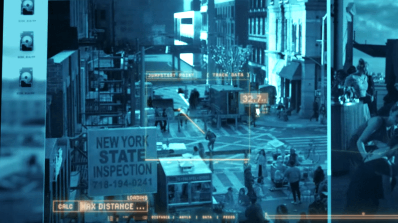
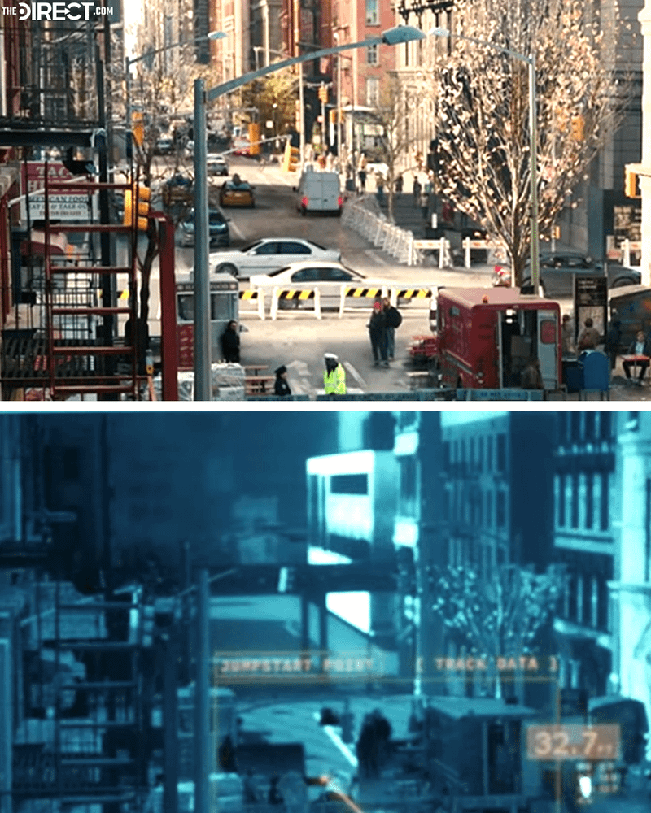
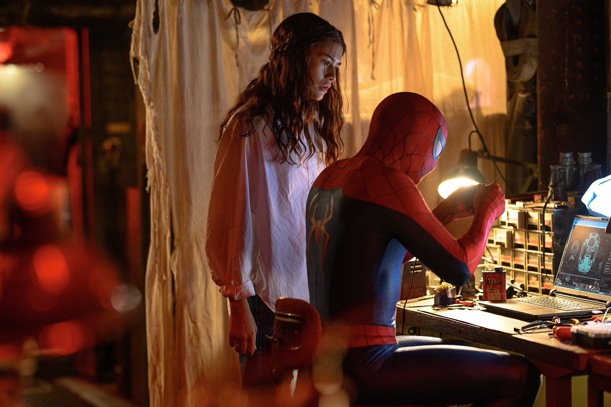
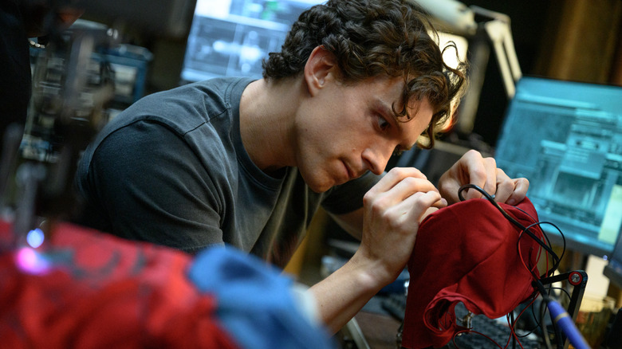
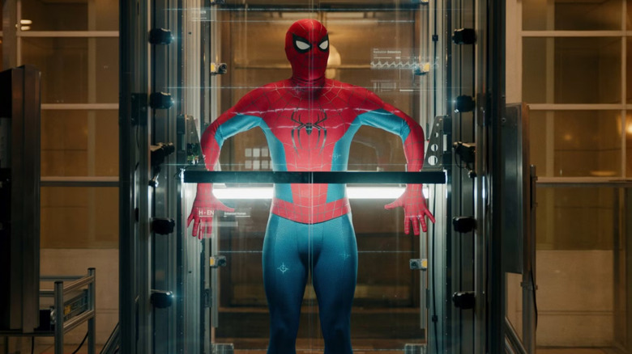

# E.V. 图片索引

本轮保存 7 张图片，均已人工打开检查。索引中的分类反映来源与实际可见内容；图片没有生成、重绘或去水印。

原始文件见 `images/`；图片的尺寸、SHA-256 和获取地址见 [manifest.json](./images/manifest.json)。下列预览使用本次工作区的绝对路径；移动资料包后，可直接打开 `images/` 中的对应文件。

## IMG01：战衣 HUD 分析画面

- 文件：`images/01-ev-hud-street.png`
- 类型：媒体刊载的片中画面；本轮未与完整影片逐帧比对。
- 可见内容：青蓝色 HUD、橙黄色分析标记、几何连线、距离数值和侧边窗格。
- 与 EV 的关系：来源文章明确将该镜头与 EV 的分析任务关联，是本资料集中最直接的视觉参考。
- 限制：不能据此推导完整桌面 UI；小字、单位与数值不作精确转录。
- 图片署名：来源页面标注 Sony Pictures。
- [来源文章](https://thedirect.com/article/spider-man-brand-new-day-sadie-sink-jean-grey-powers-scene-cgi) · [原图](https://images.thedirect.com/media/photos/nyc2.png)

## IMG02：普通镜头与 HUD 对比拼图

- 文件：`images/02-hud-comparison.png`
- 类型：媒体制作的对比拼图，带 The Direct 水印。
- 可见内容：上下排列的街景和 HUD 镜头。
- 用途：分辨摄影画面与叠加的数据界面。
- 限制：这张拼图本身不是电影中的完整一帧，不能冒充剧中界面布局。
- 图片署名：来源页面标注 Sony Pictures；拼图由媒体刊载。
- [来源文章](https://thedirect.com/article/spider-man-brand-new-day-sadie-sink-jean-grey-powers-scene-cgi) · [原图](https://images.thedirect.com/media/photos/nyc4.png)

## IMG03：普通街景参照

- 文件：`images/03-street-reference.png`
- 类型：媒体刊载的片中画面。
- 用途：与 IMG01 对照，理解 HUD 的画面底层。
- 限制：没有 EV 独立形象或专属界面，按场景参照收录。
- 图片署名：来源页面标注 Sony Pictures。
- [来源文章](https://thedirect.com/article/spider-man-brand-new-day-sadie-sink-jean-grey-powers-scene-cgi) · [原图](https://images.thedirect.com/media/photos/nyc1.png)

## IMG04：Sony 官方工作台剧照

- 文件：`images/04-workshop-official.jpg`
- 类型：Sony Pictures 瑞士官方影片页面发布的剧照。
- 可见内容：战衣调试、笔记本技术图样、工作台与电子元件收纳。
- 用途：参考设备环境和工程工作台。
- 限制：笔记本屏幕中的技术图样尚不能确认是 EV 的专属界面。
- 来源文件编号：SBND-11508_r_0。
- 图片权利：Sony 官方页面注明影片相关版权归属；未取得另行使用授权。
- [官方来源页](https://www.sonypictures.ch/index.php/fr/films/spider-man-brand-new-day) · [原图](https://www.sonypictures.ch/sites/switzerland/files/2026-06/SBND-11508_r_0.jpg)

## IMG05：Sony 官方多屏工作环境剧照

- 文件：`images/05-home-workbench.jpg`
- 类型：Sony Pictures 瑞士官方页面发布的剧照。
- 可见内容：工作台、多台显示屏和红色环境光。
- 用途：参考助理的使用场景、屏幕布置和空间氛围。
- 限制：屏幕模糊，不能可靠识别 EV 图标或界面字段。
- 来源文件编号：SBND-11292_r_xlarge_thumbnail_0。
- 图片权利：来源为 Sony 官方影片页；下载文件名含 thumbnail，不声称为原始摄影母版。
- [官方来源页](https://www.sonypictures.ch/index.php/fr/films/spider-man-brand-new-day) · [图片地址](https://www.sonypictures.ch/sites/switzerland/files/2026-07/SBND-11292_r_xlarge_thumbnail_0.jpg)

## IMG06：工作台与头套接线剧照

- 文件：`images/06-workbench-press.jpg`
- 类型：/Film 配音报道使用的电影宣传剧照。
- 可见内容：头套接线、工具与电脑屏幕。
- 用途：参考自制设备和调试环境。
- 限制：不能凭画面判断计算主机、芯片型号或音频连接方式。
- 图片署名：Jay Maidment / Sony Pictures。
- [来源文章](https://www.slashfilm.com/2226537/peter-parker-ai-assistant-ev-spider-man-brand-new-day-voice-naomi-watts/) · [原图](https://www.slashfilm.com/img/gallery/who-voices-peter-parkers-ai-assistant-e-v-in-spider-man-brand-new-day/intro-1785354530.jpg)

## IMG07：扫描场景剧照

- 文件：`images/07-scan-scene.jpg`
- 类型：/Film 文章配图，电影扫描场景。
- 可见内容：人物、扫描设备与数据叠层。
- 用途：参考身体数据的视觉呈现。
- 限制：图片本身不能证明这套扫描设备属于 EV，也不是 EV 的人形外观。
- 图片署名：Sony Pictures。
- [来源文章](https://www.slashfilm.com/2226537/peter-parker-ai-assistant-ev-spider-man-brand-new-day-voice-naomi-watts/) · [原图](https://www.slashfilm.com/img/gallery/who-voices-peter-parkers-ai-assistant-e-v-in-spider-man-brand-new-day/spider-man-brand-new-day-isnt-the-first-time-tom-holland-and-naomi-watts-have-co-starred-together-1785354531.jpg)

## 未纳入的图片

- 配音演员肖像与旧电影合照：不能作为 EV 的外形。
- 同人软件的球体、面孔或控制台：不能当成电影截图。
- 无法追溯来源的壁纸、搜索缩略图和疑似生成图。
- 剧本完整扫描页：保留[公开发布入口](https://ew.com/spider-man-brand-new-day-script-pages-opening-scene-exclusive-11960491)，未复制整页文字图片。
