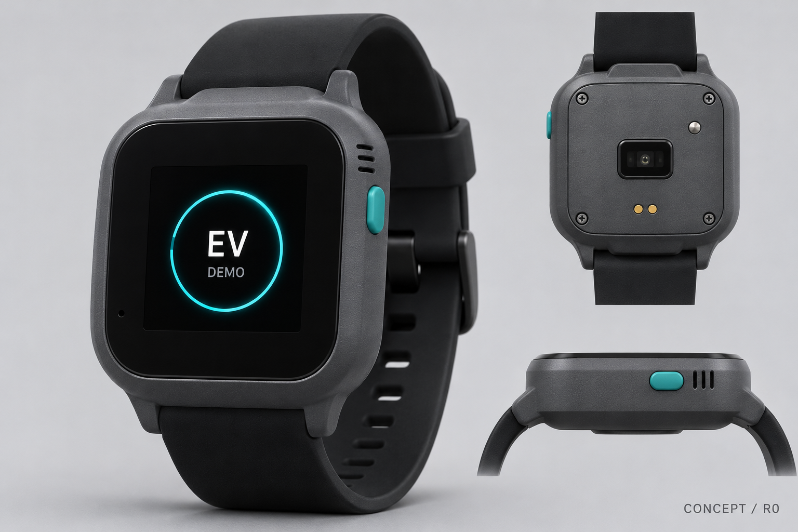
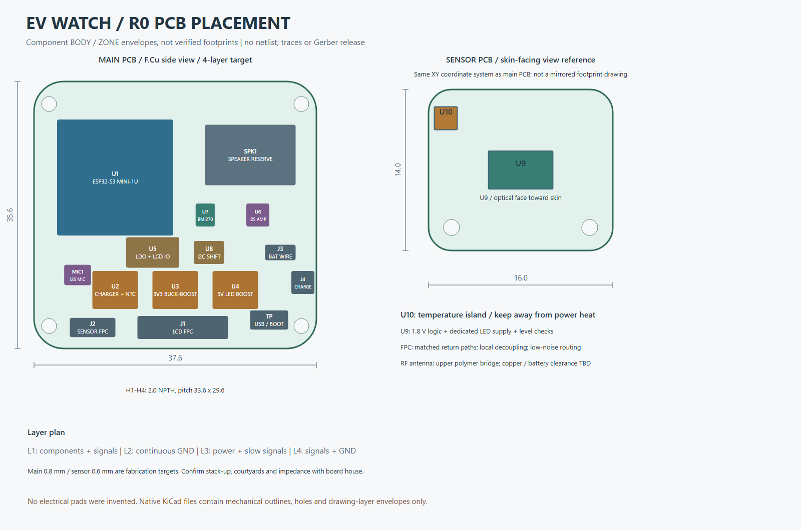

# EV 自制手表：PCB 与外形设计 R0

> 项目已更名为 YiA，手表名称为 YiA Watch；当前需求见 [YiA 产品设定](../YiA-产品设定.md)。本目录保留 R0 历史文件名与外观文字，仍为机械与分区参考，不能用于生产放行。

日期：2026-11-13。用户已选择圆角方形；尺寸和厚度尚未指定，先采用下列原型包络。

**交付级别：工程概念与机械布局。** 已提供尺寸图、器件分区、KiCad 机械板文件、参数化外壳与 STL。电气原理图、生产封装与布线尚未完成；本资料不包含可下单的 Gerber，也不是生产放行设计。

## 1. 外形

| 项目 | R0 方案 |
|---|---|
| 表体 | 46 × 44 mm，圆角 R8 |
| 厚度 | 名义 17.0 mm；含背部光学凸台约 17.8 mm |
| 表耳总长 | 54 mm |
| 表带 | 标准 22 mm 方向，开口预留 22.4 mm；实际生耳与装配需核对 |
| 显示 | 1.54 英寸、240 × 240 SPI LCD 机械参考，约 29.4 × 29.4 mm 视窗 |
| 操作 | 右侧一个实体对话键，长短按行为由固件定义；R0 未采用触摸或旋转表冠 |
| 声音 | 右上扬声器出口，左下麦克风侧孔，避免共用声道 |
| 充电 | 背部两触点充电底座方向；无外露 USB-C |
| 外壳 | 非金属主体，背盖可拆；上方塑料桥预留外置 FPC 天线空间 |

外观采用石墨灰主体、黑色表带与少量青色按键。效果图为外观意向；尺寸以参数与机械图为准。材料先以可加工聚合物原型考虑，未验证防水等级、长期皮肤接触或材料相容性。

## 2. 文件入口





| 文件 | 用途 |
|---|---|
| [外观效果图](./renders/exterior-concept.png) | 内置 image_gen 生成的外观意向，非尺寸或电气依据 |
| [生成提示词](./appearance-prompt.txt) | 实际用于外观生成的提示词；未使用 CLI 模式 |
| [尺寸图 PNG](./renders/mechanical.png) | 直接浏览 |
| [PCB 布局 PNG](./renders/pcb-layout.png) | 直接浏览 |
| [装配分解预览](./renders/cad-exploded.png) | 根据 OpenSCAD 模型渲染的名义叠层 |
| [外形尺寸 SVG](./drawings/mechanical.svg) | 正面、背面与剖面尺寸 |
| [PCB 布局 SVG](./drawings/pcb-layout.svg) | 主板与传感器板位置、层叠与预留区 |
| [主板 KiCad 文件](./pcb/ev-main-placement.kicad_pcb) | 板框、安装孔、绘图层包络；无电气焊盘或走线 |
| [传感器板 KiCad 文件](./pcb/ev-sensor-placement.kicad_pcb) | 小板板框、安装孔与传感器包络 |
| [主板轮廓 DXF](./pcb/main-outline.dxf) | 机械协同 |
| [传感器板轮廓 DXF](./pcb/sensor-outline.dxf) | 机械协同 |
| [参数文件](./design.json) | 全部名义尺寸、位置、器件候选与来源 |
| [OpenSCAD 外壳源文件](./enclosure.scad) | 编辑、装配和分件导出 |
| [主体 STL](./stl/case-body.stl) | 空壳尺寸与装配样件；不是经验证的最终佩戴外壳 |
| [背盖 STL](./stl/case-back.stl) | 传感器窗口、充电孔、安装孔与定位唇 |
| [电气架构与接口](./electrical-plan.md) | 电源、接口分配与生产设计尚待完成项 |
| [候选器件与包络](./generated/bom-candidates.json) | 非采购放行 BOM |
| [几何检查结果](./generated/geometry-checks.json) | 参数、板内包络、名义 Z 间隙及语法平衡检查 |
| [导出文件验证结果](./generated/validation-report.json) | STL 闭合边、单连通实体、包络、文件链接与机械板层数检查 |

## 3. PCB 与叠层

主板 **37.6 × 35.6 × 0.8 mm，四层目标**；传感器板 **16 × 14 × 0.6 mm，两层目标**。先用分板结构方便调试光学、皮温与语音，板间通过预留 FPC 连接。

从手腕向上，名义 Z 位置如下。Z=0 为背盖外表面，光学凸台最低点 Z=-0.8。

| 部分 | Z 范围 mm |
|---|---|
| 背盖 | 0—1.8 |
| 传感器 PCB | 3.0—3.6，光学器件朝手腕 |
| 电池总包络 | 4.6—8.6 |
| 主板 PCB | 10.0—10.8 |
| 主板高器件 | 最多到 13.3 |
| LCD 参考包络 | 13.7—15.6 |
| 盖板 | 16.2—17.0 |

电池预留 **30 × 26 × 4 mm 总包络**，要求把保护板、引线与装配余量计算在内。容量、连续与脉冲电流、充电参数必须按实际电芯资料确认；当前没有选定可采购电芯。不能从外形尺寸直接推算续航。

主板的 4 个安装孔采用 2.0 mm 名义通孔，中心距 33.6 × 29.6 mm；所有图与 CAD 共用同一坐标。背盖采用 M1.6 螺丝方向，塑料试孔与实际螺纹配合需要打样调整。

## 4. 布局决定

- 主控放左上，使用带外部天线接口的模块；避免把 PCB 天线压在电池、屏幕背板或金属外壳下。
- 扬声器放右上，麦克风靠左下侧孔；音频腔和膜片需根据真实器件设计。
- 充电、3.3 V 稳压与 LED 升压集中在下方，开关节点局部收紧。
- PPG 位于背面中央，设置独立光窗、黑色遮光结构与可替换接触圈；不能靠透明外壳直接隔空测量。
- 皮温点采用独立接触窗口与热隔离小岛方向，避免直接读取充电和主控产生的热。
- 振动器件在电池左侧留出 4 × 8 × 3 mm 包络；型号与驱动方式待定。
- 主板第二层优先连续 GND；模拟与数字按布线和电源回路控制噪声，不随意切断回流平面。
- 上方 22 × 5 mm 为天线机械占位，未选天线和线缆，不能当作已经验证的射频净空要求。

## 5. 仍需完成的工程工作

1. 锁定显示屏 FPC、天线、电池、扬声器、振动器和连接器的可采购型号及完整图纸。
2. 按锁定器件建立逐引脚原理图、封装与去耦，核对供电、默认状态、电平及保护。
3. 完成真实器件 courtyard、主板底面器件、FPC 折弯半径、线缆、紧固和装配公差校核。
4. 完成布线、生产 DRC／ERC、板厂层叠和电流／阻抗检查，再导出 Gerber 与贴片文件。
5. 做电源瞬态、充电温升、RF、收音、光学、皮温和续航测试。

当前 KiCad 文件中的器件矩形是本体或区域包络，不是厂家焊盘，也不是最终贴装边界。没有通过 KiCad 的导入、DRC 或 ERC；生成器只进行了明确列出的几何与文本检查。

## 6. 重建

```powershell
node .\generate.mjs
node .\render-cad.mjs "C:\path\to\openscad.com"
node .\verify.mjs
```

OpenSCAD 使用官方 Windows ZIP 版本运行，不需要安装到系统。保留 `enclosure.scad` 与 `generated/dimensions.scad` 的相对目录。

STL 可用于验证外形和装配空间。它未包含镜片、接触片、按键密封、声学膜、天线盖、充电底座和电池固定结构的完整生产零件。
