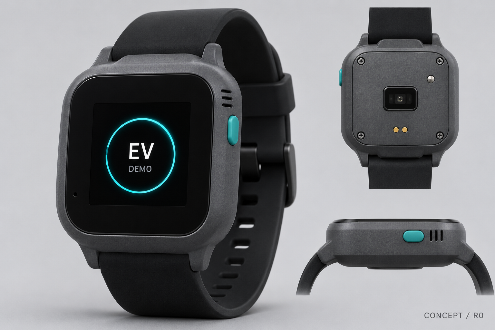

# YiA

YiA 是基于 Pi Coding Agent 规划的个人 AI 助理：通过自制 YiA Watch 感知身体状态、主动交流，并根据用户意愿远程控制家中设备。

**当前阶段：产品方案、资料研究与手表 R0 结构设计。尚未实现可运行的 YiA 应用，PCB 也未完成电气原理图与布线。**

## 当前方向

- 家中个人电脑运行 Pi、本地大模型与中文语音，安卓手机通过加密组网远程连接。
- 身体事件触发后先询问，再根据用户回复采取行动。
- 家居控制先从现有红外空调开始，逐项验证遥控指令。
- 文件、终端和 coding 复用 Pi 原生能力。

完整需求与首版验收顺序见 [YiA 产品设定](./YiA-产品设定.md)。该文件优先于早期 EV 方案。

## 资料入口

| 内容 | 入口 |
|---|---|
| 当前产品设定 | [YiA 产品设定](./YiA-产品设定.md) |
| 身体感知与主动交互 | [感知方案](./EV-身体感知与主动交互方案.md) |
| 手表外形、CAD 与 PCB 分区 | [手表 R0](./EV-watch-design-r0/README.md) |
| 早期电脑端方案 | [历史方案](./EV-v0.1-电脑端初级方案.md) |
| E.V. 公开设定与视觉参考 | [研究资料](./EV-research/README.md) |

`EV-*` 文件名保留早期项目命名，当前产品名称为 YiA，手表名称为 YiA Watch。

## 手表设计预览

效果图用于外观参考，尺寸以 CAD 为准。R0 的 KiCad 文件只包含板框、孔位与器件包络，没有电气连接或走线，不能直接用于生产。

手表目录提供 Node.js 生成与校验脚本；CAD 导出另需 OpenSCAD，图片渲染另需 Chrome 或 Edge。命令见[手表设计说明](./EV-watch-design-r0/README.md)。

## 素材说明

研究图片与引用资料的来源、署名和使用边界见[图片索引](./EV-research/02-图片索引.md)。收录不代表获得商用或再分发授权。仓库未对第三方素材授予额外许可。

Git 不收录本地环境变量、依赖目录、运行数据或重复 ZIP 导出包。
